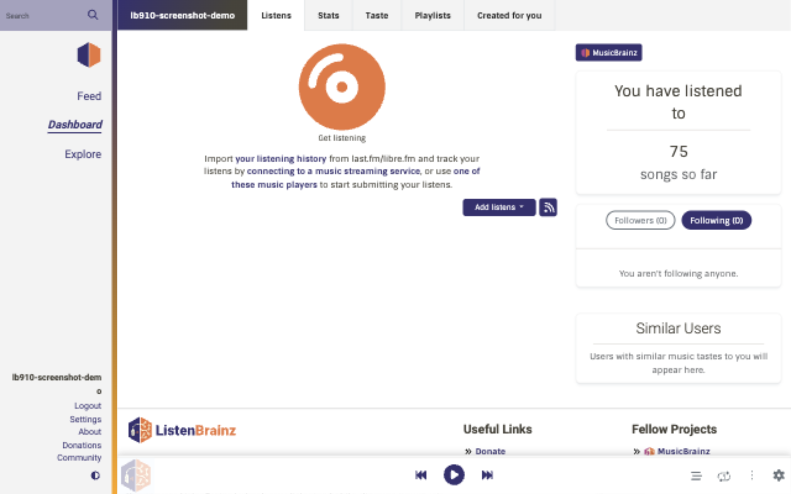
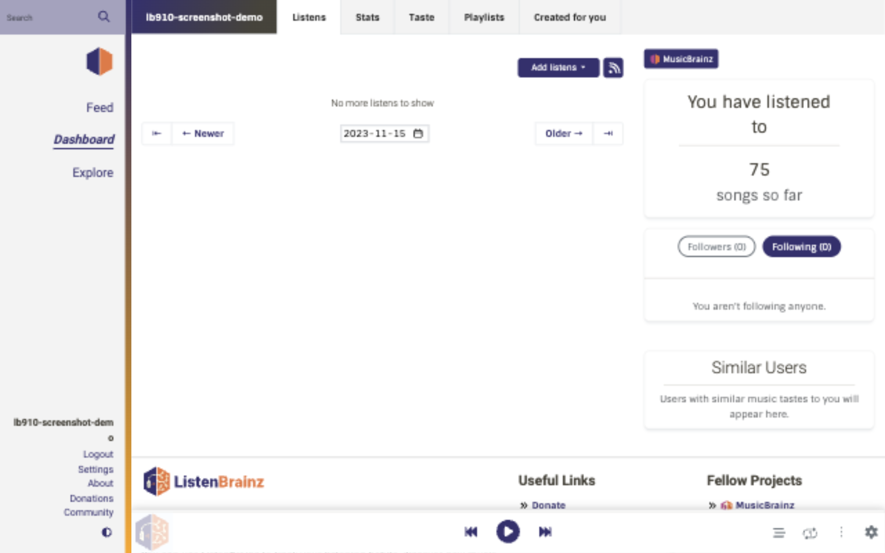
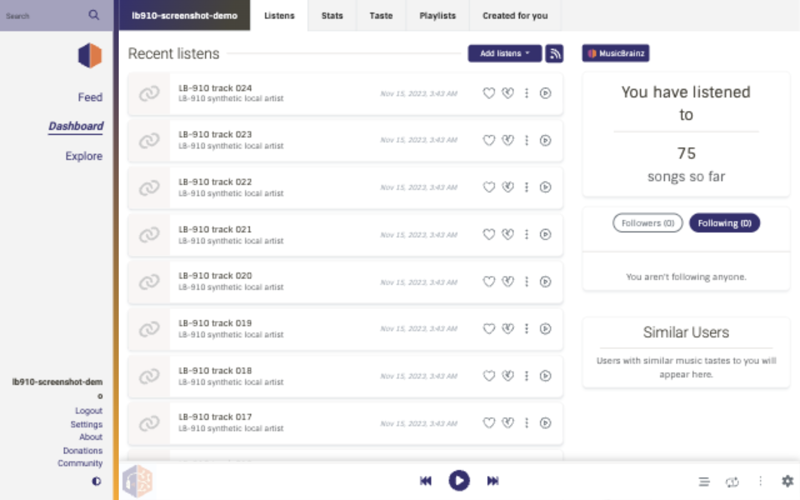

# Problem

[LB-910](https://tickets.metabrainz.org/browse/LB-910): deleting every listen on a page removes the pagination controls and shows the empty-account message, even when more listening history exists. Users must refresh to continue browsing.

# Solution

Preserve each page's original newest and oldest timestamps in its query cache when deleting listens. Keep pagination visible and its links valid after the final row is removed, with the correct newer/older limits. Subsequent pages use their own boundaries, and initially empty accounts retain their existing empty state.

Add regression coverage for both deletion orders, navigation from an emptied page, newest/oldest page limits, and initially empty accounts.

The screenshots below use the same synthetic account and page in the local Docker app. Both show the state after deleting all 25 visible listens. The Before screenshot runs the original Dashboard; After runs this fix.

| Before | After |
|---|---|
|  |  |

Clicking Older from the emptied page loads the next 25 listens without refreshing:

Validation performed locally in Docker with Node 22.23.4:

- Full frontend suite: 528 tests passed, 1 existing skip; Dashboard: 25 passed.
- Five deletion/navigation regressions fail against the original Dashboard and pass with this fix.
- TypeScript, ESLint on both changed files, and `git diff --check` passed.
- Production frontend compiled with reduced worker concurrency for the local Docker VM.
- Browser checks against the real local web/API app passed for both deletion orders, Older/Newer navigation without refreshing, page limits, and initially empty accounts. All 76 synthetic deletion requests in that validation run reached the database.

Repository-wide strict ESLint reports 0 errors and 66 warnings in unchanged files, so its zero-warning gate fails. The production build also reports warnings in unchanged code/dependencies and for asset sizes.

- [x] I have run the code and manually tested the changes.

# AI usage

- [ ] I did not use any AI.
- [x] I have used AI in this PR.

#### If you did use AI:

- [x] I used AI tools for communication.
- [x] I used AI tools for coding.
- [ ] I understand all the changes made in this PR.

Codex assisted with the implementation, regression tests, code review, Docker/browser validation, capturing the screenshots, and writing this PR description.

# Action

No additional deployment, configuration, or database migration steps are required.
